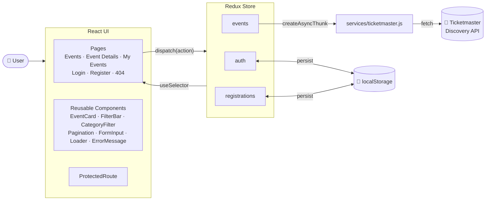
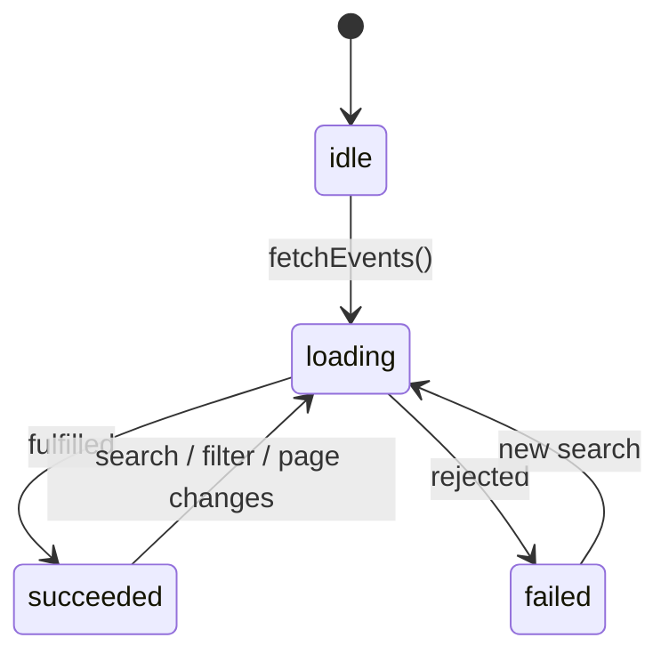
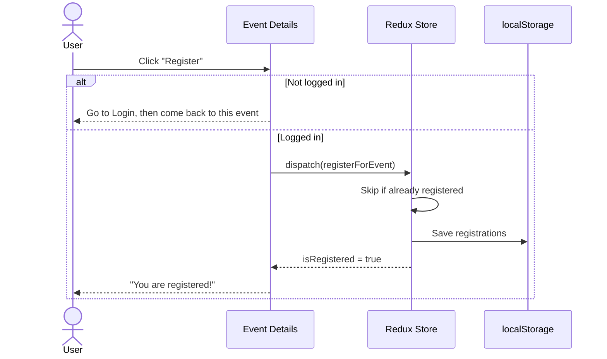
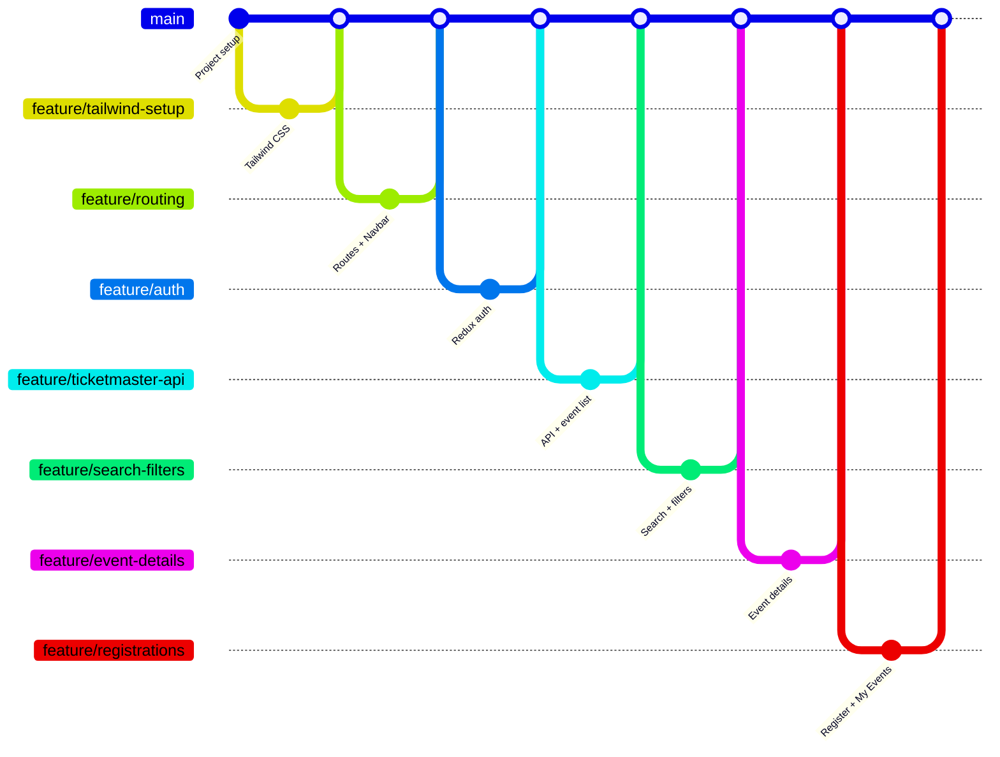

# 🎟️ EventHub

**Discover live events, save your spot, and keep track of everything you're going to — all in one place.**

EventHub pulls real, up-to-date events from the **Ticketmaster Discovery API** and lets you search, filter, explore details, and register for the ones you like. Your account and registrations stay with you across visits.


---

## ✨ Features

| | Feature | Details |
|---|---|---|
| 🔐 | **Accounts** | Register, log in, log out. Your session survives page refreshes. |
| 🔎 | **Explore events** | Live upcoming events with images, dates, venues and categories. |
| 🎯 | **Search & filter** | Keyword, city, start date, and one-click categories (Music, Sports, Arts & Theatre, Film, Miscellaneous). |
| 📄 | **Pagination** | Browse through results page by page. |
| 📍 | **Event details** | Date & time, venue, full address, genre, price range, event info, seat map, and a link to buy on Ticketmaster. |
| ✅ | **Registration** | Register in one click, duplicates are blocked, cancel any time before the event. |
| 🗓️ | **My Events** | Your registrations split into **Upcoming** and **Completed**. |
| 🛡️ | **Protected pages** | My Events requires login, and you're sent back where you were after signing in. |
| 📱 | **Responsive** | Works on phones, tablets and desktops. Clear loading, error and empty states throughout. |

---

## 🧭 How It Works

### Architecture



- **Pages** never talk to the API directly. They **dispatch actions** and **read state** with `useSelector`.
- The **events** slice uses async thunks, which call the **service layer**, the only file that knows Ticketmaster's URLs and data shape.
- **auth** and **registrations** are saved to `localStorage` after every change, so nothing is lost on refresh.

### Loading an event list

Every API request moves through the same lifecycle, and the UI shows a spinner, an error, or results to match:



### Registering for an event



---

## 🚀 Getting Started

### 1. Prerequisites
- **Node.js 18+** and npm
- A free **Ticketmaster API key**: sign up at [developer.ticketmaster.com](https://developer.ticketmaster.com/), open **My Apps**, and copy the **Consumer Key**

### 2. Clone and install
```bash
git clone https://github.com/Abdul-Rehman474/event-management-system.git
cd event-management-system
npm install
```

### 3. Add your API key
```bash
cp .env.example .env
```
Then open `.env` and paste your key:
```
VITE_TICKETMASTER_API_KEY=your_consumer_key_here
```

### 4. Run it
```bash
npm run dev
```
Open **http://localhost:5173** 🎉

| Command | What it does |
|---|---|
| `npm run dev` | Start the development server |
| `npm run build` | Build for production |
| `npm run preview` | Preview the production build |
| `npm run lint` | Check the code with ESLint |

---

## 🗂️ Project Structure

```
src/
├── app/
│   └── store.js                    # configureStore + localStorage sync
├── features/
│   ├── auth/authSlice.js           # register · login · logout
│   ├── events/eventsSlice.js       # fetchEvents · fetchEventById · filters
│   └── registrations/registrationsSlice.js  # registerForEvent · cancelRegistration
├── services/
│   └── ticketmaster.js             # API calls + turns raw data into clean objects
├── components/                     # Reusable UI building blocks
├── pages/                          # One component per route
└── utils/                          # localStorage helpers, date formatting
```

### Redux state at a glance

| Slice | Holds | Saved to localStorage |
|---|---|---|
| `auth` | registered users, current user, auth errors | ✅ |
| `events` | event list, selected event, filters, page, loading/error status | ❌ always fresh from the API |
| `registrations` | each registration with the user's email and an event snapshot | ✅ |

### Routes

| Path | Page | Access |
|---|---|---|
| `/` | Events: search, filters, categories, pagination | Everyone |
| `/events/:id` | Event details and registration | Everyone (login to register) |
| `/login` · `/register` | Account forms | Everyone |
| `/my-events` | Your upcoming and completed events | 🔒 Logged-in users |
| `*` | 404 page | Everyone |

---

## 💡 Design Decisions

- **Feature-based folders.** Each Redux slice lives with its feature, so related logic stays together.
- **A single service layer.** Ticketmaster's deeply nested responses are flattened once in `formatEvent()`, so every component works with simple fields like `event.venue` and `event.city`.
- **Filters live in Redux.** Search terms and the current page survive navigating to an event and back.
- **Registrations store an event snapshot.** My Events renders instantly without extra API calls (the API allows only 2 requests per second).
- **Derived data isn't stored.** Upcoming and completed lists are calculated from the registrations on each render, so there's never a second copy to keep in sync.
- **Timezone-aware date filter.** The API filters in UTC, so results are also checked against each venue's local date.

---

## ⚠️ Notes & Limitations

- **Authentication is simulated in the browser.** Accounts and passwords are kept in `localStorage`, which is **not secure** and is only suitable for demos. A real app would use a backend with hashed passwords.
- The API key is kept out of Git with `.env`, but in a frontend-only app it is still visible in the built JavaScript.
- Ticketmaster limits: **5,000 requests/day**, **2 requests/second**, and only the first **1,000 results** (50 pages) of any search can be browsed.
- Some events have no price range, description or seat map in Ticketmaster's data; those sections are simply hidden.

---

## 🔀 Development Workflow

Every feature was built on its own branch and merged into `main` through a Pull Request:



---

## 👤 Author

**Abdul Rehman** · [@Abdul-Rehman474](https://github.com/Abdul-Rehman474)
